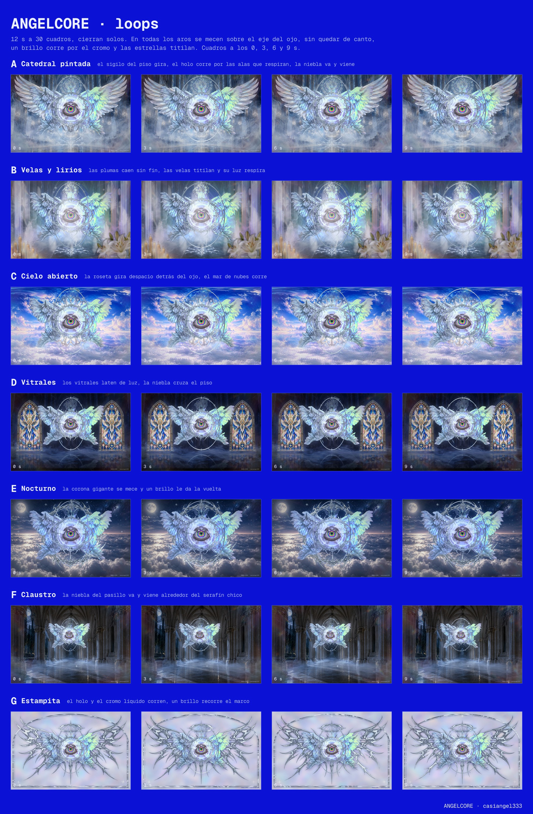
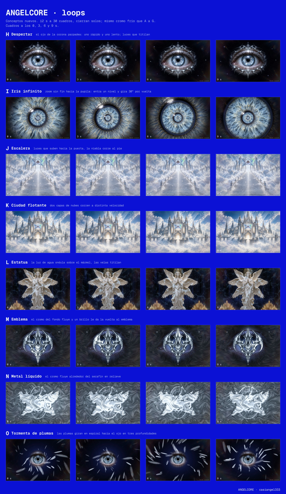
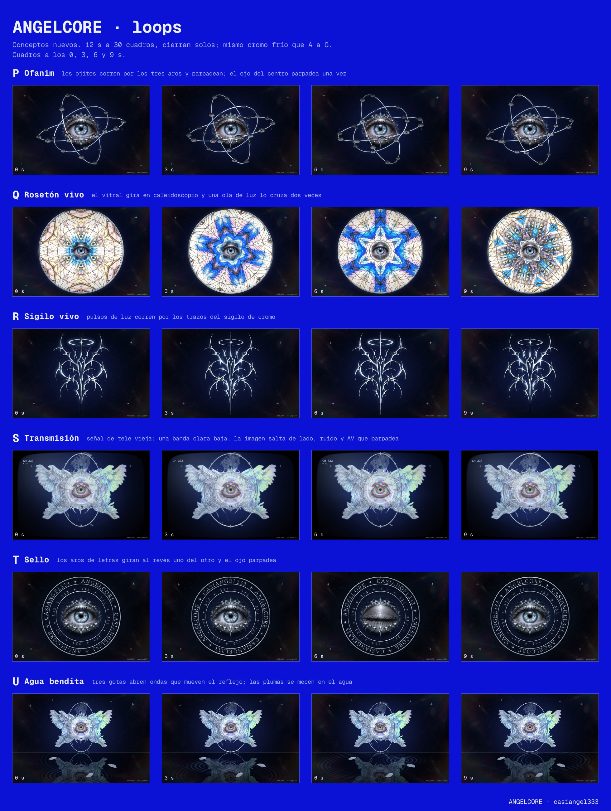
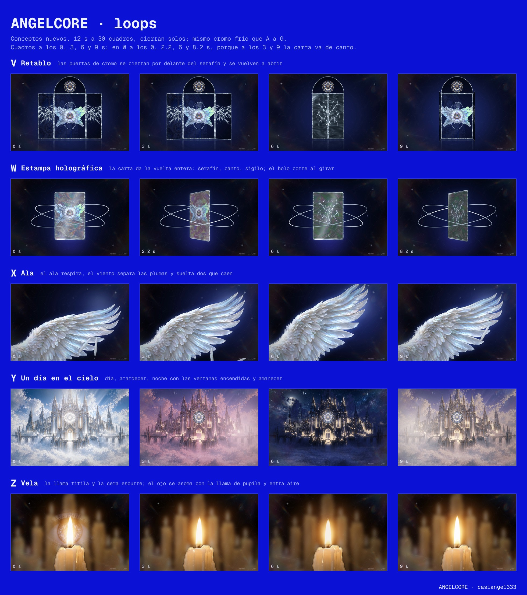

# ANGELCORE · fondos

Fondos animados de Angelcore (casiangel333). Son 26 loops de 12 s a 30 fps y 1920×1248, y cierran solos.

**Galería para verlos en el navegador:** https://hermannpr.github.io/angelcore-fondos/

## Hojas

## Loops

| | Nombre | Video |
|---|---|---|
| A | Catedral pintada | [loop-A.mp4](loops/loop-A.mp4) |
| B | Velas y lirios | [loop-B.mp4](loops/loop-B.mp4) |
| C | Cielo abierto | [loop-C.mp4](loops/loop-C.mp4) |
| D | Vitrales | [loop-D.mp4](loops/loop-D.mp4) |
| E | Nocturno | [loop-E.mp4](loops/loop-E.mp4) |
| F | Claustro | [loop-F.mp4](loops/loop-F.mp4) |
| G | Estampita | [loop-G.mp4](loops/loop-G.mp4) |
| H | Despertar | [loop-H.mp4](loops/loop-H.mp4) |
| I | Iris infinito | [loop-I.mp4](loops/loop-I.mp4) |
| J | Escalera | [loop-J.mp4](loops/loop-J.mp4) |
| K | Ciudad flotante | [loop-K.mp4](loops/loop-K.mp4) |
| L | Estatua | [loop-L.mp4](loops/loop-L.mp4) |
| M | Emblema | [loop-M.mp4](loops/loop-M.mp4) |
| N | Metal líquido | [loop-N.mp4](loops/loop-N.mp4) |
| O | Tormenta de plumas | [loop-O.mp4](loops/loop-O.mp4) |
| P | Ofanim | [loop-P.mp4](loops/loop-P.mp4) |
| Q | Rosetón vivo | [loop-Q.mp4](loops/loop-Q.mp4) |
| R | Sigilo vivo | [loop-R.mp4](loops/loop-R.mp4) |
| S | Transmisión | [loop-S.mp4](loops/loop-S.mp4) |
| T | Sello | [loop-T.mp4](loops/loop-T.mp4) |
| U | Agua bendita | [loop-U.mp4](loops/loop-U.mp4) |
| V | Retablo | [loop-V.mp4](loops/loop-V.mp4) |
| W | Estampa holográfica | [loop-W.mp4](loops/loop-W.mp4) |
| X | Ala | [loop-X.mp4](loops/loop-X.mp4) |
| Y | Un día en el cielo | [loop-Y.mp4](loops/loop-Y.mp4) |
| Z | Vela | [loop-Z.mp4](loops/loop-Z.mp4) |
